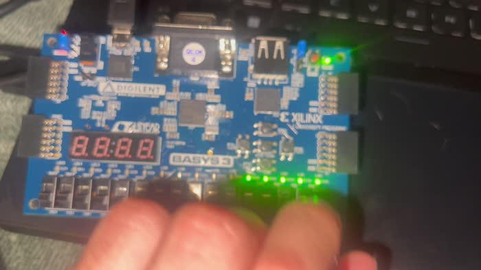

# RISC-V and FPGA laboratory

Single-cycle RISC-V processors and Basys 3 digital-logic projects recovered from CSCE A342 coursework at the University of Alaska Anchorage (Fall 2024).

The collection brings the RTL, input programs, test vectors and original board demonstrations together. The processor follows a course-adapted textbook design; the recovered extension adds **LUI and XOR**. See [attribution](NOTICE.md) and [source provenance](PROVENANCE.json).

## Start here

| Project | What to inspect | Verification |
|---|---|---|
| [RISC-V LUI/XOR extension](riscv/lui-xor) | Immediate decoding, result selection and XOR operation | Companion simulation verifies `0xBEEEF009` stored at address `0x58` with PC `0x14` |
| [RISC-V baseline](riscv/baseline) | Course-adapted single-cycle datapath and controller | Baseline program simulation reports success |
| [8-bit ALU](fpga/alu) | Button-selected operations, testbench and recovered vectors | 13 original vectors, zero errors |
| [T-Bird Tail Lights Project](fpga/t-bird-tail-lights) | State machine, clock divider and submitted variant | Historical board demonstrations below |
| [Seven-segment RAM](fpga/seven-segment-ram) | RAM, display, input conditioning and constraints | Historical board demonstration below |
| [Rotary counter](fpga/rotary-counter) | Counter and Basys 3 constraints | Historical board demonstration below |
| [Other digital-logic exercises](fpga) | Flip-flops, muxes, counters, decoder, traffic controller and combinational circuits | Recovered sources; see validation scope |

## Board demonstrations

These are original 2024 recordings transcoded to MP4. The videos show historical hardware behavior; they are not evidence of a new synthesis or board run in 2026. Each link opens the full recording from the repository's media release.

| Demonstration | Video | Source |
|---|---|---|
| Binary-to-thermometer | [Watch/download](https://github.com/legooz/riscv-fpga-lab/releases/download/portfolio-media-2026-10/binary-to-thermometer.mp4) | [RTL](fpga/binary-to-thermometer) |
| Flip-flop logic | [Watch/download](https://github.com/legooz/riscv-fpga-lab/releases/download/portfolio-media-2026-10/flip-flop-logic.mp4) | [RTL](fpga/flip-flops) |
| Rotary counter | [Watch/download](https://github.com/legooz/riscv-fpga-lab/releases/download/portfolio-media-2026-10/rotary-counter.mp4) | [RTL](fpga/rotary-counter) |
| T-Bird tail-light sequence | [Watch/download](https://github.com/legooz/riscv-fpga-lab/releases/download/portfolio-media-2026-10/taillight-sequence.mp4) | [RTL](fpga/t-bird-tail-lights) |
| T-Bird tail lights: alternate sequence | [Watch/download](https://github.com/legooz/riscv-fpga-lab/releases/download/portfolio-media-2026-10/taillight-extra-credit.mp4) | [Submitted variant](fpga/t-bird-tail-lights/submitted-variant) |
| Seven-segment RAM | [Watch/download](https://github.com/legooz/riscv-fpga-lab/releases/download/portfolio-media-2026-10/seven-segment-ram.mp4) | [RTL](fpga/seven-segment-ram) |
| ALU | [Watch/download](https://github.com/legooz/riscv-fpga-lab/releases/download/portfolio-media-2026-10/alu-demo.mp4) | [RTL and vectors](fpga/alu) |

[](https://github.com/legooz/riscv-fpga-lab/releases/tag/portfolio-media-2026-10)

## Run the simulations

With Icarus Verilog (`iverilog` and `vvp`), GNU `timeout` (from coreutils), and a POSIX shell installed:

```sh
sh scripts/check.sh
```

The script compiles and runs the LUI/XOR, baseline and ALU checks. It requires their success messages and uses timeouts so a nonterminating simulation fails. Original RTL behavior is preserved; the LUI/XOR result-checking harness was added during portfolio organization. See [VALIDATION.md](VALIDATION.md) for warnings and untested areas.

Each FPGA subdirectory is a separate exercise. Do not compile the entire collection as one design: several exercises intentionally reuse module names. `historical-variants/` holds distinct local versions that have not been promoted to the primary examples.

Explore the related [ARM assembly exercises](https://github.com/legooz/arm-assembly-lab), [low-level C/C++ projects](https://github.com/legooz/c-cpp-portfolio), or the full [engineering portfolio index](https://github.com/legooz/engineering-portfolio).
